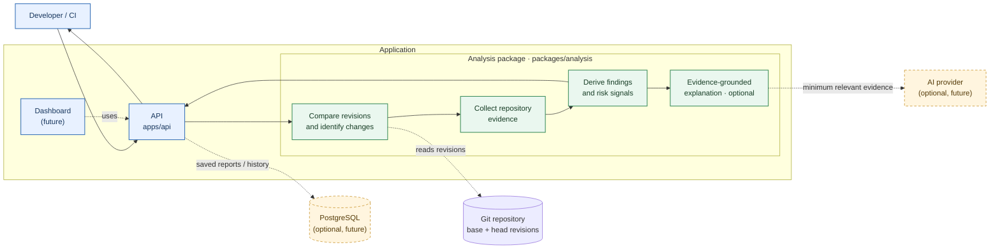

# Architecture

## Purpose

AI Release Risk Analyzer reviews a proposed software change and reports which
parts of a codebase may be affected, which tests are relevant, and what release
risks deserve attention. Results should be useful in a code review: each
finding should be traceable to repository evidence, and analysis should not
claim certainty that the evidence does not support.

This document describes the proposed design. The repository currently contains
the project outline, not an implemented system.

## Design principles

- **Evidence before explanation:** derive findings from the diff and repository
  structure; use AI to explain evidence, not to invent it.
- **Deterministic core:** the same repository state and analysis settings should
  produce the same static findings.
- **Useful without AI:** static analysis should produce a valid report even when
  an AI provider is unavailable or disabled.
- **Explicit uncertainty:** distinguish observed facts from inferred impact,
  and include missing or incomplete evidence.
- **Small, replaceable parts:** keep analysis independent of the API, UI,
  persistence, and AI provider.

## System boundaries

The analysis package owns the domain logic and report types. The API validates
requests, coordinates analysis, and returns results. A future React +
TypeScript dashboard presents reports; it does not calculate risk. PostgreSQL
is an optional persistence layer for saved reports and history, not a
prerequisite for analyzing a change.

## Analysis flow

1. **Accept a comparison.** Identify the repository and the base and head
   revisions to compare. Validate the request and ensure both revisions are
   available.
2. **Build the change set.** Compute the diff and collect changed paths and
   relevant change metadata. Treat file contents and repository metadata as
   untrusted input.
3. **Collect evidence.** Inspect repository structure and supported metadata to
   find relationships such as imports, references, configuration ownership,
   and test-to-code links. Record the source and kind of each relationship.
4. **Derive findings.** Apply documented static rules to identify potentially
   affected components, candidate tests, and risk signals. Keep the rule and
   evidence behind each finding available to the report.
5. **Explain, optionally.** If enabled, an AI provider may turn collected
   evidence into a concise explanation. It must not add unsupported impacted
   files, tests, or risks. Provider failures should be reported as unavailable
   explanations; they must not erase static findings.
6. **Return a report.** Include the compared revisions, findings, evidence,
   analysis limitations, and any partial failures. Persist the report only
   when a persistence feature is configured.

## Analysis package and report

`packages/analysis` should expose a small, typed interface that accepts a
comparison and analysis options and returns a structured report. It should not
depend on HTTP, database, or UI frameworks.

At minimum, a report should carry:

- base and head revision identifiers;
- changed files;
- affected-component candidates and the evidence supporting each candidate;
- candidate tests and why they are relevant;
- risk signals, their severity, and their supporting evidence;
- analysis status, limitations, and errors that affected completeness.

Represent evidence with a kind (for example, changed file, dependency edge, or
test reference) and a repository location when one is available. Keep static
findings distinct from AI-generated explanation so consumers can display,
filter, or omit AI content without losing the underlying analysis.

## Risk model

The first version should use explicit, reviewable signals rather than an opaque
single AI-generated score. For each signal, record:

- what was observed;
- why it may matter to a release;
- which evidence supports it;
- severity and confidence, where the rule can justify them.

Any aggregate risk summary should be derived from those signals using a
documented rule. It is a prioritization aid, not a prediction of whether a
release will fail. Avoid presenting precision unsupported by the available
repository evidence.

## Initial scope and growth

### MVP

- Compare two revisions and identify changed files.
- Return a structured analysis result.
- Establish the API and analysis-package boundary.
- Report unavailable or incomplete analysis explicitly.

### Next

- Map dependencies and identify potentially affected components.
- Identify candidate tests using repository evidence.
- Add evidence-grounded AI explanations.
- Add a React + TypeScript dashboard.
- Persist reports in PostgreSQL if users need report history.

### Deferred

- Historical retrieval-augmented generation (RAG) and pgvector.
- Python-based analysis.

Each extension should be added only when its evidence sources, failure behavior,
and report impact can be made explicit.

## Reliability and safety

- Never execute repository scripts, tests, or build steps as part of analysis by
  default. If execution is added later, it needs explicit isolation, resource
  limits, and opt-in behavior.
- Bound work by repository size, diff size, and analysis time; return a clear
  partial result or error when a limit is reached.
- Do not expose secrets or unrestricted repository contents to an AI provider.
  Send only the minimum relevant evidence, and make provider use configurable.
- Keep credentials and provider configuration outside source control.
- Do not trigger deployments, merges, or release decisions. The report informs
  a human reviewer.
- Test the static analysis independently from the API and AI integration,
  including empty diffs, renamed/deleted files, unsupported repository
  metadata, and partial failures.
